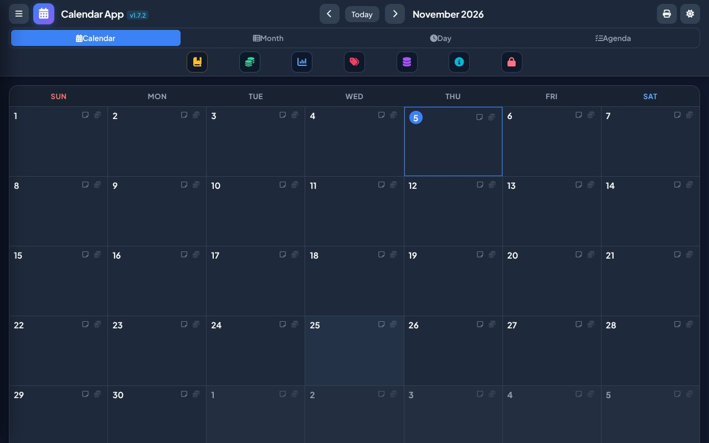

<div align="center">

# 📅 Calendar App

**A private calendar, diary and daily organiser that keeps everything on your own device, encrypted.**

[](CHANGELOG.md)
[](https://github.com/SRathinaGiri/CalendarApp/releases)
[](https://github.com/SRathinaGiri/CalendarApp/releases)
[](#-privacy)
[](SECURITY.md)
[](LICENSE)

### [⬇ Download for Android or Windows](https://github.com/SRathinaGiri/CalendarApp/releases)

**[📖 User guide: how to use every feature](docs/USER_GUIDE.md)** · [PDF](docs/CalendarApp-User-Guide.pdf)



🪔 *Part of the [Diwali Mega Gift Week 2026](https://srathinagiri.github.io/#gift-week): one free app every day, 6–12 November.*

</div>

---

## ✨ What it does

- **Calendar, Month table, Day and Agenda views** for schedules, with multi-date scheduling (long-press a day).
- **Daily diary notes** for any date.
- **Travel planner**: onward and return legs, PNR, train/flight details, and e-ticket attachments. IRCTC PDF tickets are read automatically, on the device.
- **Daily receipts and payments** with a simple chart of accounts, ledgers, trial balance and summary statements, all in ₹ with Indian digit grouping.
- **Print or save a month as PDF**: a wall-calendar grid or a 30-day diary table.
- **Reports**: free days, schedules, travel ticket costs and a reimbursement claim statement with ticket copies.

## 📲 Install

Open the **[Releases](https://github.com/SRathinaGiri/CalendarApp/releases)** page on the device you want to use.

| Device | File | How to install |
|---|---|---|
| **Android 7+** | `CalendarApp-v….apk` | Tap it and allow **Install unknown apps** for your browser or file manager when asked. Updates install over it and keep your data. |
| **Windows 10/11** | `CalendarApp-Windows-Setup-v….exe` | Run it. No admin rights are needed. If SmartScreen says *"Windows protected your PC"*, choose **More info → Run anyway** (the installer is not code-signed). |

> The `.aab` file in the Android release is for the Google Play Store. Phone users should install the `.apk`.

**First start:** choose a PIN or passphrase (6+ characters). The app then shows an **Emergency Recovery Key**. Save it somewhere safe: it is the only way back in if you forget your PIN. New to the app? The **[user guide](docs/USER_GUIDE.md)** walks through everything with screenshots.

## 🔒 Privacy

- **No account, no cloud, no ads, no analytics, no tracking.**
- Your calendar, notes, money entries and attachments are encrypted (AES-256-GCM) and stored only on your device.
- **Daily automatic backup** to `Documents › SRGCalendar` (last 14 days), which survives uninstalling. Copy it to Drive or a USB stick now and then.
- **Full backup and restore** (`.zip`) from the side menu, optionally encrypted with your PIN. Use it to move to a new phone or PC.
- Fingerprint unlock on Android. Automatic lock after 5 minutes idle.

Details and the threat model are in [SECURITY.md](SECURITY.md).

## ⚠️ Please note

- The receipts and payments module is a **personal record-keeping aid**. It is not accounting, bookkeeping or tax software, and its reports are not meant to be filed with or certified to any authority. Check figures independently before relying on them.
- The reimbursement claim statement is a convenience printout. Check it against your actual tickets and your organisation's rules.
- If you forget your PIN **and** lose the recovery key, your data cannot be recovered. There is no server and no reset.

## 🌐 Browser version

The original browser (PWA) version still runs at **[srathinagiri.github.io/CalendarApp](https://srathinagiri.github.io/CalendarApp/)**. Browsers can clear site data without asking, so for daily use install the Android or Windows app.

**Moving from the browser to the app:** in the browser, *Backup & Restore → Export Full (.zip)*. In the app, set a PIN, then *Restore Full (.zip)* with the PIN the backup was made with.

---

## 🛠 For developers

<details>
<summary><b>Run, build and release</b></summary>

**Run the web version locally.** Browsers need HTTP to load WebAssembly, so use a local server:

```bash
python -m http.server 8080      # or: npx serve . -p 8080
```

Then open <http://localhost:8080>. There is no build step for the web app: edit the files and reload.

**Android** (Capacitor, `android/`): `npm install`, `npm run sync`, then open `android/` in Android Studio. CI builds need the repository secrets `ANDROID_KEYSTORE_BASE64` and `ANDROID_KEYSTORE_PASSWORD` (alias `srgcalendar`). Every release must be signed with that same key.

**Windows** (Electron, `desktop/`): data lives under `%APPDATA%\Calendar App`, with the same private copy and daily backup as Android.

**CI:** `.github/workflows/android-apk.yml` and `windows-app.yml` build and publish releases.

**Releasing:** update `APP_VERSION` in `app.js`, the version badges in `index.html`, `CACHE_NAME` in `sw.js`, the version badge in this README, and [CHANGELOG.md](CHANGELOG.md).

</details>

<details>
<summary><b>How the encryption works</b></summary>

- **Envelope encryption.** A random 256-bit data key encrypts the database (`SRGE3` header), snapshots and attachments. The PIN (PBKDF2-SHA256, 600,000 iterations, own salt), the fingerprint token and the Emergency Recovery Key each only *wrap* that data key, so changing the PIN never re-encrypts your data. Older `SRGE1`/`SRGE2` data is upgraded automatically at the first PIN unlock.
- **Keys stay in memory.** Runtime keys are imported as non-extractable and never written to `sessionStorage` or `localStorage`. Raw key bytes are zeroed after derivation.
- **Fail-closed.** Once a PIN is set, the app refuses to write unencrypted data.
- **Biometrics** use the WebAuthn PRF extension for hardware-backed key wrapping, with no plaintext fallback.
- **Throttling.** Progressive delays (3 s, 10 s, 30 s) after failed PIN attempts.
- **Backups** carry per-file SHA-256 hashes in `manifest.json` to detect corruption. Optional AES-256-GCM encryption covers the database and every attachment. Restore is atomic and rolls back on failure.
- **Strict Content Security Policy.** `'wasm-unsafe-eval'` is allowed for WebAssembly only, and PDF.js runs with `isEvalSupported: false`. The app makes no third-party network requests.

Full details: [SECURITY.md](SECURITY.md).

</details>

<details>
<summary><b>Project structure</b></summary>

| Path | Purpose |
|---|---|
| `index.html` | App shell, markup and Content Security Policy |
| `app.js` | Application logic (database, encryption, views, reports) |
| `native-store.js` | Native storage bridge for the Android and Windows apps |
| `styles.css` | Styles (dark/light themes, print layouts) |
| `sw.js` | Service worker for the browser version (`CACHE_NAME` must be bumped on every release) |
| `manifest.json`, `icon-*.png` | PWA manifest and icons |
| `taxonomy_seed.js` | Default tag categories for a fresh database (generic, no personal data) |
| `android/`, `desktop/` | Capacitor (Android) and Electron (Windows) shells |
| `sql-wasm.*`, `pdf*.js`, `jszip.min.js`, `pako.min.js`, `vendor/` | Bundled third-party libraries, fonts and icons. See [THIRD_PARTY_NOTICES.md](THIRD_PARTY_NOTICES.md) |

</details>

### 🤝 Contributing

Issues and pull requests are welcome. Please:

- Never include real personal data (names, schedules, PNRs, amounts, PAN, Aadhaar, bank details) in issues, screenshots or test files. Use obviously synthetic data.
- Keep the app free of runtime dependencies: no CDN links and no external `fetch()`. Bundle any new library locally and add it to `THIRD_PARTY_NOTICES.md` and `sw.js`.
- Report security issues privately as described in [SECURITY.md](SECURITY.md).

## 📄 License

[MIT](LICENSE) © S. Rathinagiri. Bundled third-party components keep their own licences: see [THIRD_PARTY_NOTICES.md](THIRD_PARTY_NOTICES.md).
