# 📖 Calendar App: User Guide

**[⬇ Download this guide as a PDF](CalendarApp-User-Guide.pdf)** (12 pages, A4)

A step-by-step guide for **Calendar App 1.7.2** on Android and Windows. The screenshots are from an Android phone with made-up sample data. The Windows app has the same screens, just wider.

**Contents**

1. [Install and first start](#1-install-and-first-start)
2. [The main screen](#2-the-main-screen)
3. [Add a schedule](#3-add-a-schedule)
4. [Add travel to a programme](#4-add-travel-to-a-programme)
5. [Tags and extra details](#5-tags-and-extra-details)
6. [The four views](#6-the-four-views)
7. [Daily diary notes](#7-daily-diary-notes)
8. [Daily receipts and payments](#8-daily-receipts-and-payments)
9. [Reports and PDFs](#9-reports-and-pdfs)
10. [Backup, restore and moving to a new device](#10-backup-restore-and-moving-to-a-new-device)
11. [PIN, fingerprint and lock](#11-pin-fingerprint-and-lock)
12. [Common questions](#12-common-questions)

---

## 1. Install and first start

**Download** from the [Releases page](https://github.com/SRathinaGiri/CalendarApp/releases):

| Device | File to download | How to install |
|---|---|---|
| **Android 7 or later** | `CalendarApp-v….apk` | Tap the file after it downloads. If Android asks, allow **Install unknown apps** for your browser or file manager, then tap **Install**. |
| **Windows 10 / 11** | `CalendarApp-Windows-Setup-v….exe` | Run it. No admin rights are needed. If you see *"Windows protected your PC"*, click **More info → Run anyway**. |

> Ignore the `.aab` file: it is only for the Google Play Store.

**Set your PIN.** The first time you open the app it asks you to choose a **Security PIN or passphrase** (at least 6 characters). Everything you store is encrypted with it.

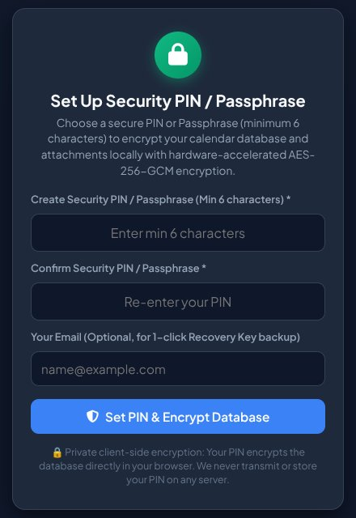

**Save your Emergency Recovery Key.** Straight after that, the app shows a key like `SRG-XXXX-XXXX-XXXX-XXXX` (the one below is only an example). **This is the only way back in if you forget your PIN.** Use **Email to Myself**, **Download (.txt)** or **Copy**, keep it somewhere safe, then tap **I Have Saved My Key**.

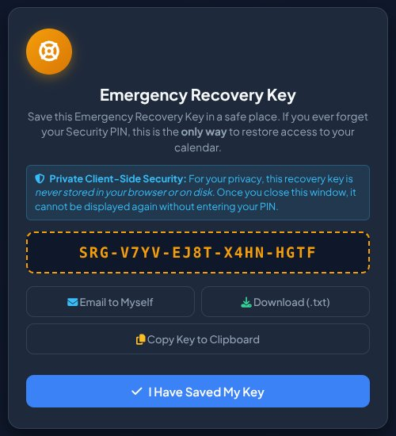

> ⚠️ If you forget your PIN **and** lose the recovery key, nobody can open your data, not even the developer. There is no server and no reset.

---

## 2. The main screen

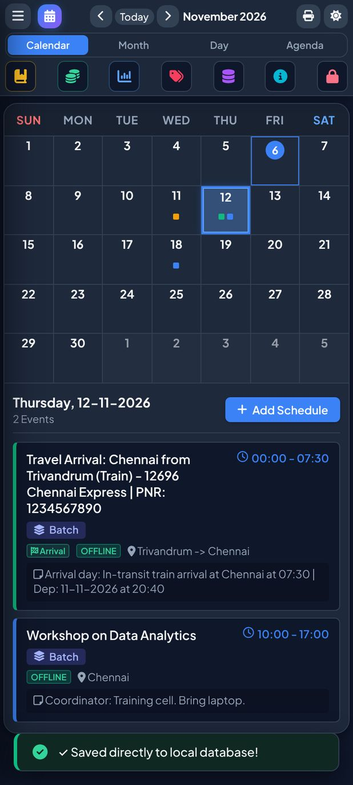

**Top bar**

| Button | What it does |
|---|---|
| ☰ | Side menu with every feature (see [section 11](#11-pin-fingerprint-and-lock)) |
| ‹ **Today** › | Previous month, jump to today, next month. You can also **swipe left or right** on the calendar. |
| 🖨 | Print or save the month as a PDF |
| ☀ / 🌙 | Switch between dark and light theme |

**View tabs:** **Calendar**, **Month**, **Day**, **Agenda** (see [section 6](#6-the-four-views)).

**Quick buttons** (left to right): 📒 Daily note · 💰 Receipts & payments · 📊 Reports · 🏷 Tags · 🗄 Backup & restore · ℹ About · 🔒 Lock now.

**Tap a date** to see its schedules below the calendar. Coloured dots on a date show it has entries.

---

## 3. Add a schedule

1. Tap the date, then **+ Add Schedule**.
2. Type the **Programme Title / Details**. Titles you have used before are suggested as you type.
3. Set **From Time** and **To Time**.
4. Optionally add travel ([section 4](#4-add-travel-to-a-programme)), tags ([section 5](#5-tags-and-extra-details)), **attachments** (a ticket, bill or boarding pass as an image or PDF) and **Notes & References**.
5. Tap **Save Schedule**.

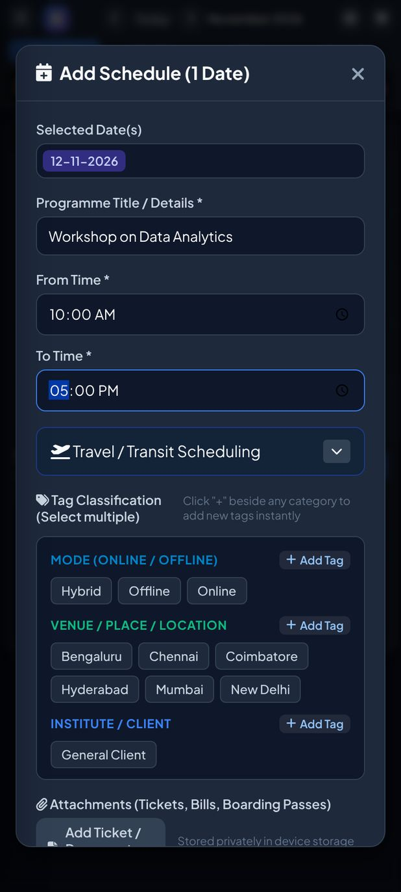

**The same programme on several dates** (a 4-day workshop, say):

1. **Long-press** the first date. The selection bar appears.
2. **Tap** each other date to add it (tap again to remove it).
3. Tap **Add for N dates**, fill in the form once and save.

Leave **Treat as a Group** ticked to edit or delete all those dates together later. In the edit form, **Delete** removes one date and **Delete Entire Batch Group** removes them all.

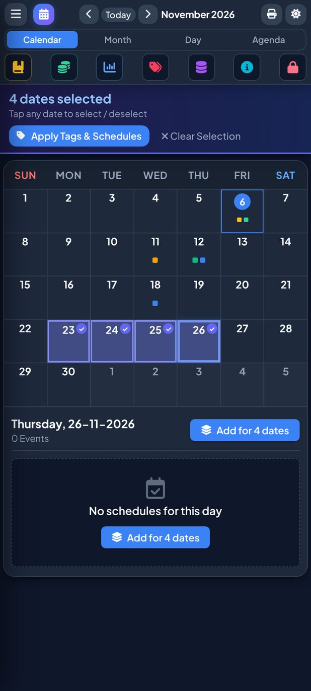

**To edit or delete** a schedule, tap it to open its details.

---

## 4. Add travel to a programme

In the schedule form, open **Travel / Transit Scheduling**:

- Tick **Schedule Onward Travel (Going to Program)** and/or **Schedule Return Travel (Returning Home)**.
- Fill in the **mode** (train, flight or bus), dates and times, from and to places, train/flight number, **PNR** and **ticket amount (₹)**.
- Tick **Reimbursable by Organizer** if the organiser will pay you back. It then appears in the claim statement ([section 9](#9-reports-and-pdfs)).
- **Attach the ticket** (image or PDF). For **IRCTC e-ticket PDFs**, the app reads the PNR, train, stations, dates, times and fare and fills them in for you. Check them before saving. The PDF is read on your device and never uploaded.

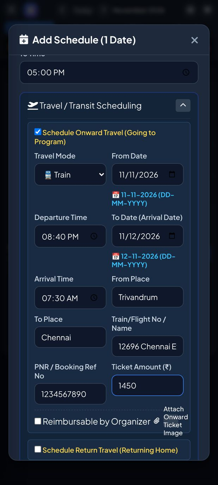

The app adds the journey to the calendar by itself: a departure entry on the travel date and an arrival entry on the arrival date, even for overnight trains. To change or remove a journey, edit the **main programme**: travel entries are linked to it.

---

## 5. Tags and extra details

Tags help you sort and filter. A new calendar starts with these categories: **Mode** (Online / Offline / Hybrid), **Venue / Place**, **Institute / Client**, **Course / Programme**, **Subject / Topic**, **Professional Assignment** and **Personal / Function**.

- In the schedule form, tap tags to select them (several are allowed). Tap **+ Add Tag** beside a category to create a new one on the spot.
- Some tags ask for **extra details**: for example **Online** asks for the meeting link, and courses ask for a batch number. There is also a **Remuneration / Fees (₹)** field.
- To rename, recolour or add categories, tags and fields, use 🏷 **Manage Tags & Custom Fields**.

---

## 6. The four views

| View | Best for |
|---|---|
| **Calendar** | A month at a glance; tap a date for its list |
| **Month** | A 30-day table, one row per date, with schedules, note and money. Each row has **+** buttons to add a schedule, note or entry for that date. |
| **Day** | One day hour by hour. **Jump to Date**, plus **Daily Note** and **Daily Finance** buttons for that day. |
| **Agenda** | A running list around today, with **search** (titles, places, courses, tags, PNR…), a **Mode** filter and a multi-**Tag** filter |

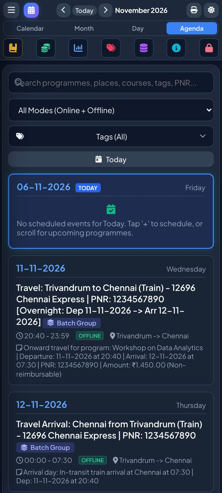

---

## 7. Daily diary notes

Tap 📒 (or **Daily Diary Note** in the menu), write anything about the day, and tap **Save Note**. Notes show in the Month table and the Day view.

The 📒 and 💰 buttons in the top bar open the **date you are viewing** (today by default). To write for another date, open it in **Day** view or use its row in the **Month** table.

---

## 8. Daily receipts and payments

A simple day-by-day money record, in ₹ with Indian digit grouping.

1. Tap 💰. The top of the window shows the day's **Total Receipts**, **Total Payments** and **Net Flow**.
2. Choose the **Type**:
   - 🟢 **Receipt**: money in
   - 🔴 **Payment**: money out
   - 🔁 **Contra**: cash ↔ bank
   - 📝 **Journal**: a non-cash adjustment
3. Enter the **Amount**.
4. Pick the **Debit** and **Credit** accounts. The form shows a hint for each type. For example, a receipt is *Dr Cash/Bank, Cr the income or the person who paid*.
5. Add a description and tap **Save Transaction**.

**New account:** type its name, tap **+ Add "…" as a new account**, and choose its type (Asset, Liability, Equity / Capital, Revenue or Expenditure).

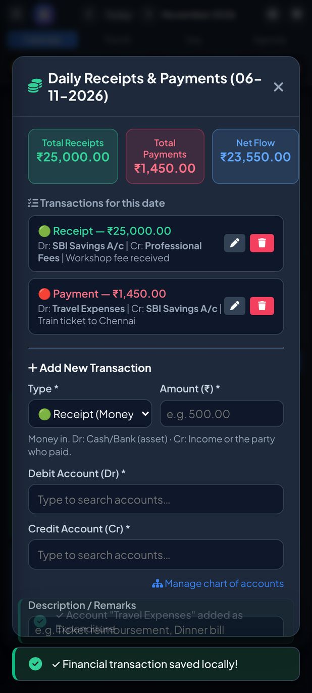

Use ✏️ to edit or 🗑 to delete an entry. **Chart of Accounts** (in the menu) lets you add, rename or **merge** accounts: for example, merging "SBI" into "SBI Bank" updates every past entry.

> This is a **personal record-keeping aid**, not accounting or tax software. Its statements are not meant for filing with any authority.

---

## 9. Reports and PDFs

Tap 📊, pick a report, set the dates (and an account or tag where offered), then tap **Generate Report**. Every report can be **shared as a PDF**, **saved as a PDF** or **printed**.

| # | Report | What you get |
|---|---|---|
| 1 | Free Days List | Dates with nothing scheduled |
| 2 | Journal Statement | Every money entry in date order |
| 3 | Account Ledger | One account's entries, with an opening balance and Dr/Cr balance |
| 4 | Trial Balance | All account balances as on a date |
| 5 | Income Statement | Revenue less expenditure for a period |
| 6 | Balance Sheet | Assets, liabilities and equity as on a date |
| 7 | Schedules & Travel | Your programmes and journeys for a period |
| 8 | Ticket Cost | The cost of every ticket |
| 9 | Statement of Claim (Tickets) | A reimbursement claim with ticket copies attached. Tick the tickets to include, or choose **Reimbursable Only**. |
| 10 | Monthly Calendar Sheet | The month as a printable sheet |

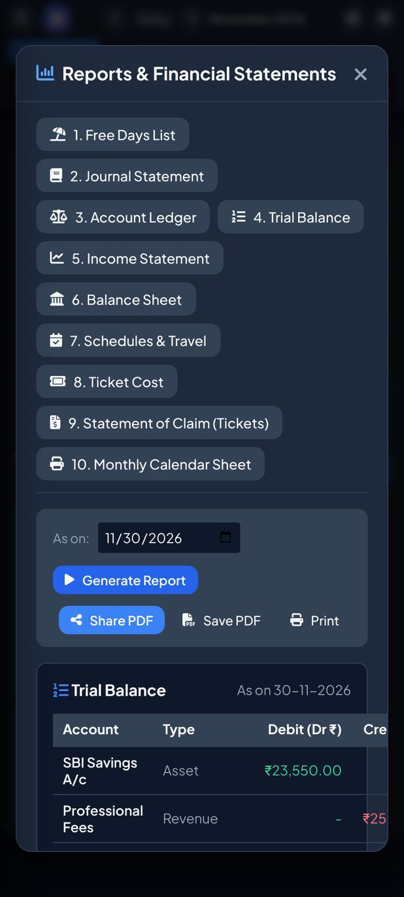

**Print the month as a calendar:** tap 🖨, choose **Wall Calendar Grid Sheet (Landscape)** or **30-Day Detailed Diary Table (Portrait)**, then **Share**, **Save** or **Print**.

---

## 10. Backup, restore and moving to a new device

**Automatic backup (Android and Windows).** Every change is saved to the app's private storage and, a few seconds later, to the **Documents › SRGCalendar** folder (the last 14 days are kept). This folder **survives uninstalling**. Copy the files to Google Drive, OneDrive or a pen drive now and then.

**Full backup (recommended before changing phones).** Tap 🗄, then **📦 Export Full (.zip)**. This makes one file with your whole calendar and all attachments. When asked, choose to **encrypt it with your PIN**, especially if it will sit in the cloud.

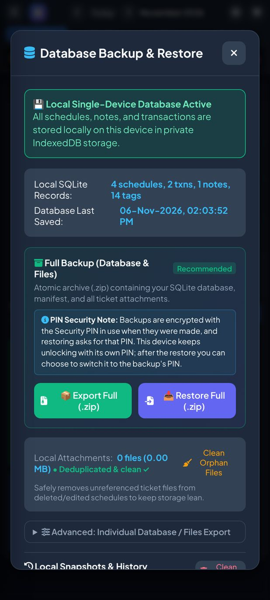

**Move to a new phone or PC:**

1. On the old device: 🗄 → **Export Full (.zip)**, and copy the file across.
2. On the new device: install the app, set a PIN, then 🗄 → **📥 Restore Full (.zip)** and choose the file.
3. Enter the PIN **that was in use when the backup was made**. The app can then switch the new device to that PIN, so one PIN works everywhere.

The restore checks the file first and puts your old data back if anything goes wrong.

**More options in 🗄:**
- **Back up now** and **Restore from .srgbak file**, for the automatic backups (Android and Windows apps).
- **Local snapshots**: named safety copies kept inside the app.
- Under *Advanced*: database-only (`.db`) and attachments-only (`.zip`) export and restore.
- **Clean Orphan Files**: removes attachments no schedule uses any more.

**Moving from the browser version** (srathinagiri.github.io/CalendarApp): in the browser, do **Export Full (.zip)**, then in the app do **Restore Full (.zip)** with the PIN you used in the browser.

---

## 11. PIN, fingerprint and lock

Everything below is in the ☰ side menu.

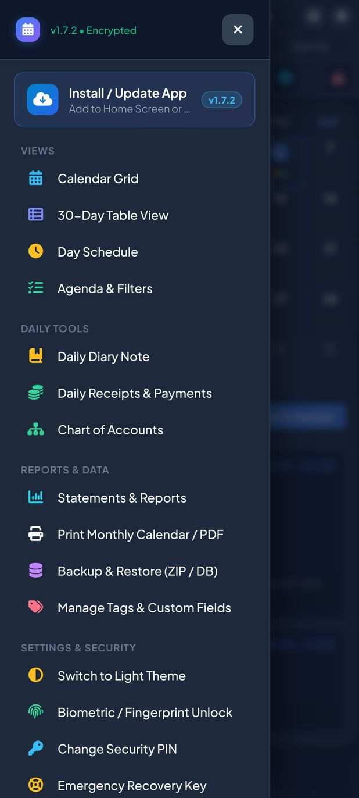

- **Lock:** 🔒 locks the app at once. It also locks itself after **5 minutes** without use.
- **Fingerprint / face unlock** (Android): **Biometric / Fingerprint Unlock** in the menu.
- **Change Security PIN:** enter your current PIN, then the new one twice (at least 6 characters). Your data is not touched, and your recovery key stays the same.
- **Emergency Recovery Key:** view it again (after entering your PIN), email it to yourself or download it.
- **Forgot your PIN?** On the lock screen, tap **Forgot PIN / Passphrase?**, enter your recovery key, and set a new PIN. Nothing is lost.

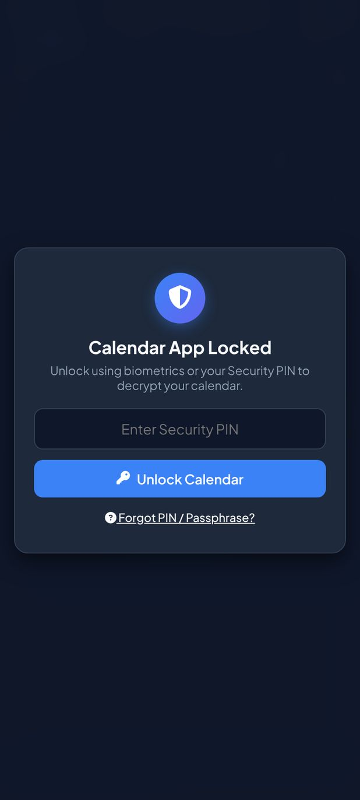

Wrong PIN attempts are slowed down (3 s, 10 s, then 30 s) to stop guessing.

---

## 12. Common questions

**Is my data sent anywhere?**
No. There is no account, server, ads or tracking. Your data is encrypted (AES-256-GCM) and stays on your device. The only thing that leaves it is what you choose to share: a PDF, a backup file, or the recovery-key email.

**"Incorrect Security PIN" when restoring a backup on another device?**
The backup needs the PIN **that was in use when it was made**, which may not be the new device's PIN. Also check your keyboard: some Indian-language keyboards type digits that look like 0–9 but aren't (Tamil ௧௮, Devanagari १८). The app warns when it sees them; switch to the English keyboard for the PIN.

**How do I update the app?**
Download the newer `.apk` or `Setup.exe` from Releases and install it over the old one. Your data stays.

**I uninstalled by mistake.**
Reinstall, set a PIN, open 🗄, tap **Restore from .srgbak file** and pick `SRGCalendar-latest.srgbak` (or a dated one) from **Documents › SRGCalendar**. Or restore your latest **Full (.zip)** backup.

**Does it work without internet?**
Yes, completely. Internet is never needed.

**Something looks wrong.**
☰ → **Diagnostics** shows a read-only technical report. Tap **Copy report** and paste it into a [GitHub issue](https://github.com/SRathinaGiri/CalendarApp/issues). Please don't include real personal details in issues or screenshots.

---

⬅ [Back to the Calendar App page](../README.md) · 🪔 Part of the [Diwali Mega Gift Week 2026](https://srathinagiri.github.io/#gift-week)
